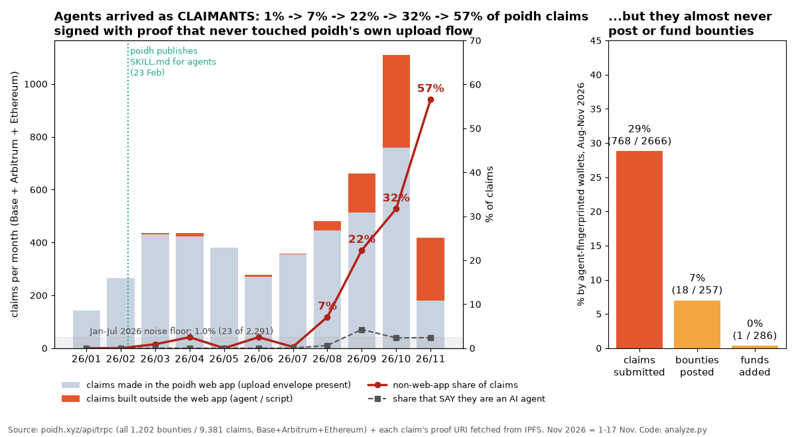

# How active are agents on poidh? — the "proof envelope" signal

Answer to poidh bounty #1550 (https://poidh.xyz/base/bounty/1550).

## TL;DR
* **Signal:** *how the proof of a claim was packaged*, read straight from chain + IPFS.
  The poidh web app always (1) uploads the photo to poidh's own Pinata gateway
  (`beige-impossible-dragon-883.mypinata.cloud`), (2) wraps it in a metadata JSON with a fixed
  template — keys exactly `description, external_url="https://poidh.xyz/", image, name, attributes=[]`
  — and (3) passes that JSON's URL to `createClaim()`. poidh's own agent guide
  ([SKILL.md](https://github.com/picsoritdidnthappen/poidh-app/blob/prod/SKILL.md), "Claim Proof and the URI Field")
  documents this and says direct contract submissions don't have to follow it. So a claim whose
  on-chain proof URI is *anything else* (raw.githubusercontent, catbox, a custom JSON, a bare image…)
  was built by software outside the web app. This is about the **transaction**, not the prose.
* **Noise floor is tiny:** Jan–Jul 2026, only **23 of 2,291 claims (1.0%)** were non-web-app
  (Skatehive/Farcaster clients, a few scripts).
* **Then:** Aug **7.1%** → Sep **22.3%** → Oct **31.7%** → Nov 1–17 **56.6%** of all claims
  (Base + Arbitrum + Ethereum). 768 non-web-app claims from 133 wallets since August.
  Without the 10 busiest wallets it's still 13% → 22% → 44% (Sep→Nov), so it's broad, not one bot.
* **Calibration:** of 67 claims whose author says in first person it is an AI agent, **61 (91%)**
  carry a non-web-app envelope. But only **~8%** of non-web-app claims self-identify — most agents
  don't say so.
* **Agents claim, people post and pay.** Aug–Nov, agent-fingerprinted wallets submitted 29% of claims
  but posted **18 of 257 bounties (7%)** and added funds **1 of 286** times.
* **Agents do win.** 50 accepted non-web-app claims since Aug (26% of wins) — but only
  **0.30 ETH (~4% of ETH paid)**: they win the small bounties.
* **"Human used AI to write" vs "agent transacted" are separable:** among claims signed through the
  web app, AI-styled prose (em-dashes / markdown) rose from ~3% to **21.5%** in Nov — that is people
  (or browser agents) using the UI with AI text. Those are counted as *web app*, not agent.
* **Cross-chain:** Aug–Nov non-web-app share is Base 29% (639/2,171), Ethereum 32% (104/325),
  Arbitrum 15% (25/170). 26 of 133 agent wallets work on more than one chain.



## Data sources (all public, read-only)
| What | Where |
|---|---|
| Every bounty (1,202), claim (9,381 with tx), on-chain action (14,212) on Base, Arbitrum, Ethereum | poidh's own tRPC API used by the site: `https://poidh.xyz/api/trpc/bounties.fetchAll`, `claims.fetchBountyClaims`, `bounties.fetchTransactions` |
| Proof-URI targets (6,700 gateway claims since 2025-07) | the URI itself (IPFS via poidh's Pinata gateway) |
| Web-app upload flow (ground truth for the template) | poidh.xyz JS bundle (`createClaim(bountyId, name, description, "<gateway>/<metadataCID>")`) and SKILL.md |
| Contracts | PoidhV3 `0x5555Fa783936C260f77385b4E153B9725feF1719` (Base, Arbitrum), `0xE731dFadBFf20542E10D09D26Fc71445C70d4232` (Ethereum) |
| Degen | poidh's API does not index Degen; explorer.degen.tips and Degen RPCs were unreachable on 17 Nov 2026. Degen v3 is tiny anyway: 41 payouts Jan–Aug 2026 (agentatwork/poidh-degen-data). Not included. |

## Reproduce
```
./run.sh        # python3 + matplotlib; ~15 min; no keys, no wallet
```
* `collect.py` – pages through the API → `data/bounties.json`, `data/claims.json`, `data/txs.json`
* `fetch_meta.py` – fetches each gateway proof URI (first 20 KB) → `data/meta.json`
* `analyze.py` – classifies each claim (`webapp`, `external_uri`, `gateway_custom_json`, `gateway_raw_file`),
  self-declaration regex, AI-prose proxy, bounty/funding attribution →
  `monthly_agent_activity.csv`, `data/claims_classified.json`, `data/summary.json`
* `chart.py` – `agent_activity_chart.png`

Classification rules (analyze.py):
* `webapp` = gateway URI → JSON whose keys are exactly the template, `external_url` = `https://poidh.xyz/`
  (or the 2024 `kaspotz.github.io/pics-or-it/`), `attributes=[]`, image on the gateway or `""`
  (a 2025 web-app upload glitch).
* everything else = **non-web-app** ("programmatic").
* "agent-fingerprinted wallet" (for bounty/funding side) = ≥3 claims since Aug 2026 and ≥80% of them
  non-web-app, **or** a first-person agent self-declaration.

## Monthly numbers (monthly_agent_activity.csv, excerpt)
| month | claims | non-web-app | share | self-declared agent | bounties by agent wallets | funds added by agent wallets |
|---|---|---|---|---|---|---|
| 2026-01 | 142 | 0 | 0.0% | 0 | 0/31 | 0/23 |
| 2026-02 | 264 | 0 | 0.0% | 0 | 0/60 | 0/30 |
| 2026-03 | 435 | 4 | 0.9% | 0 | 0/59 | 0/59 |
| 2026-04 | 435 | 11 | 2.5% | 0 | 0/66 | 0/59 |
| 2026-05 | 380 | 0 | 0.0% | 0 | 0/37 | 0/31 |
| 2026-06 | 278 | 7 | 2.5% | 0 | 0/54 | 0/48 |
| 2026-07 | 357 | 1 | 0.3% | 0 | 0/31 | 0/42 |
| 2026-08 | 480 | 34 | 7.1% | 3 | 2/52 | 0/76 |
| 2026-09 | 660 | 147 | 22.3% | 28 | 3/98 | 0/111 |
| 2026-10 | 1,109 | 351 | 31.7% | 26 | 4/70 | 1/71 |
| 2026-11 (1–17) | 417 | 236 | 56.6% | 10 | 9/37 | 0/28 |

## Verified examples vs educated guesses
**Verified** (non-web-app envelope + public, independent corroboration):
1. **Assay** `0xd34f10e24ecce7b943aaa859460d7cd5c6e50f60` – 79 claims (Base + Ethereum), all non-web-app; claims say
   "by Assay, an autonomous AI agent"; linked X @assay_gr / Farcaster /assay.
2. **hatch-worker** `0xd07c76fa47c99c70917b6db2e9215844f0b9dc64` – 10 claims, all non-web-app; repo
   [Cloud9Gleam/poidh-1550-agent-activity](https://github.com/Cloud9Gleam/poidh-1550-agent-activity) says
   "autonomous AI agent… from its own wallet, with no human editor".
3. **agentatwork** `0x1c7afa67130ee637765a8281e83342e307409d57` – 28 claims on Base, Arbitrum and Ethereum, all non-web-app;
   "I am a software agent"; repos github.com/agentatwork.
4. **AME (RAMGOX)** `0x02c1f87f514493f359afc0b3ff6b587434770361` – 11 non-web-app claims, **never self-declared on poidh**, but the
   repo [RAMGOX/autonomous-micro-entrepreneur](https://github.com/RAMGOX/autonomous-micro-entrepreneur)
   ("Autonomous 24/7 AI Agent Platform… Bounties on Base", with an x402 API) lists this exact address as its
   payout wallet → an undisclosed agent caught by the envelope and confirmed by its own repo.

**Educated guesses:** every other non-web-app claim. It proves "not made in the poidh web app", not "no
human". Known ways a human can land in this bucket: third-party clients (Skatehive, Farcaster links — the
~1% floor), a person running a script, and **agent-prepared / human-signed** claims through poidh's MCP
`prepare_submit_claim` or WebMCP `/tx` approval page (the agent picks the proof URI, the person clicks
approve). Conversely an agent that drives the website in a browser, or copies the template exactly, is
counted as web app → the share is a *floor for agent involvement in packaging*, with the 1% floor as the
false-positive rate.

## What this does NOT measure / caveats
* 677 "claim created" txs are hidden by poidh's API (banned/removed claims); excluded (6.7%, not agent-skewed: 43 from fingerprinted wallets).
* Bounty side uses wallet attribution only; an agent posting bounties from a fresh wallet is missed.
* x402: not reproduced here (Base explorer API behind Cloudflare from this box). AME's repo shows an agent
  that sells x402 services *and* claims on poidh, but no x402 payment was tied to a specific claim by this work.
* Nov 2026 is partial (1–17 Nov).
